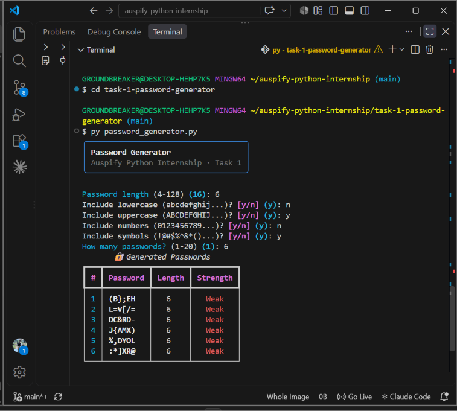
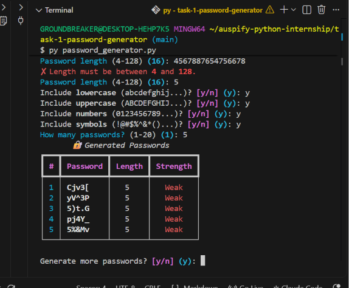

# Task 1 – Password Generator

A command-line Python app that generates secure, customizable passwords, built as part of the **Auspify Technologies Python Development Internship**.

## Features
- **Custom length**: choose any length from 4 to 128 characters (default 16)
- **Choose character types**: lowercase, uppercase, numbers and symbols
- **Guaranteed variety**: every selected character type appears at least once
- **Multiple passwords**: generate up to 20 at a time
- **Strength rating**: each password is rated Weak, Medium, Strong or Very Strong
- **Secure randomness**: uses `random.SystemRandom`, which draws from the operating system's secure random source
- **Input validation**: rejects out-of-range lengths and requires at least one character type
- **Rich terminal UI**: styled prompts and a results table using the [Rich](https://github.com/Textualize/rich) library

## Skills Practised
Python basics · Random module · String manipulation · Functions · Input validation · Third-party libraries (Rich)

## How to Run
Requires Python 3.8+.

```bash
cd task-1-password-generator
py -m pip install -r requirements.txt
py password_generator.py
```

## Screenshots
| Choosing options | Generated passwords |
|---|---|
|  |  |

## How It Works
1. The user picks a length and which character types to include.
2. The generator takes one random character from each selected type, so every type is guaranteed.
3. It fills the remaining length from all selected characters combined.
4. It shuffles the result so the guaranteed characters aren't always at the start.

## Project Structure
```
task-1-password-generator/
├── password_generator.py  # Main application
├── requirements.txt       # Dependencies (rich)
├── README.md
└── screenshots/
```

## Author
**Aliyer Bakers Musaazi** – [GitHub](https://github.com/amusaazi-sudo) · [LinkedIn](https://linkedin.com/in/aliyer-musaazi)