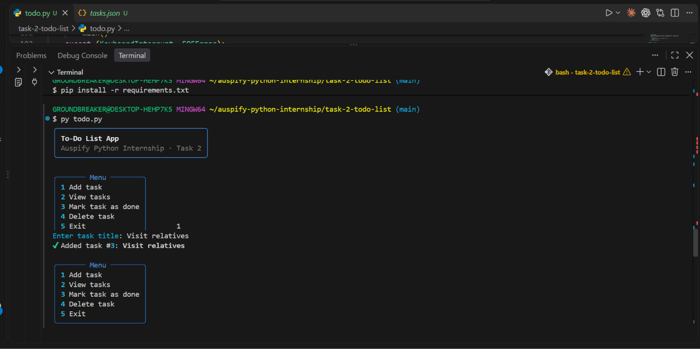
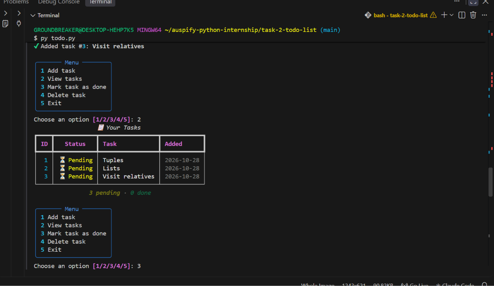
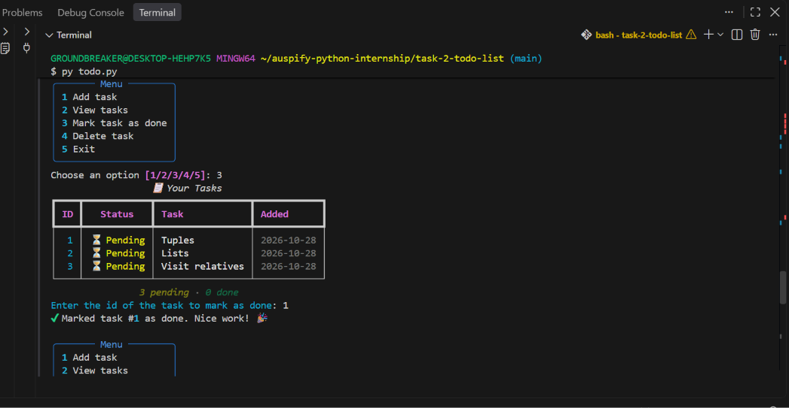
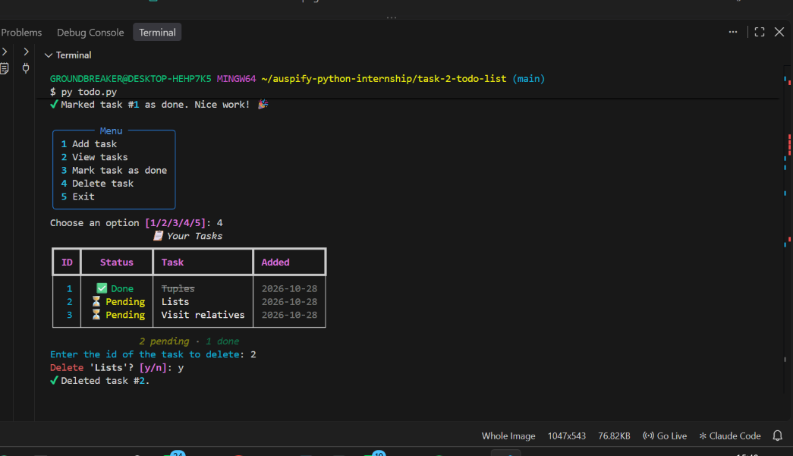

# Task 2 – To-Do List Application

A command-line Python app for managing daily tasks, built as part of the **Auspify Technologies Python Development Internship**.

## Features
- **Add tasks** with automatic ids and creation dates
- **View tasks** with their status and a pending/done count
- **Mark tasks as completed**
- **Delete tasks**, with a confirmation prompt
- **Persistent storage**: tasks are saved to `tasks.json` after every change
- **Input validation**: handles empty titles, non-numeric ids and missing tasks

## Skills Practised
File handling (JSON) · Lists and dictionaries · CRUD operations · Input validation · Functions

## How to Run
Requires Python 3.8+ (no external libraries).

```bash
cd task-2-todo-list
python todo.py
```

## Screenshots
| Menu & adding tasks | Viewing tasks |
|---|---|
|  |  |

| Completing a task | Deleting a task |
|---|---|
|  |  |

## Project Structure
```
task-2-todo-list/
├── todo.py        # Main application
├── tasks.json     # Created automatically on first run
├── README.md
└── screenshots/
```

## Author
**Aliyer Bakers Musaazi** – [GitHub](https://github.com/amusaazi-sudo) · [LinkedIn](https://linkedin.com/in/aliyer-musaazi)